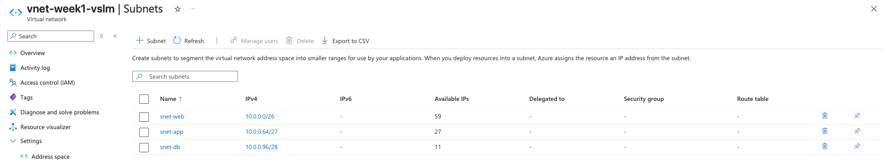

# Week 5 — VNet with VLSM-sized subnets

## Lab: Rebuild the Week 2 VNet, sizing each subnet myself

### Scenario
A small company needs three tiers in Azure, each with a known maximum number of VMs:

| Subnet | Purpose | Max VMs |
|---|---|---|
| snet-web | Web servers | 50 |
| snet-app | App servers | 20 |
| snet-db | Databases | 8 |

### What I built
- Resource group `rg-week1-vlsm` (North Europe), tagged `Environment = test`
- VNet `vnet-week1-vlsm` with address space `10.0.0.0/16`
- Default subnet removed; three subnets added using VLSM (largest first, each starting where the last ended)

| Subnet | Size | Azure usable | Range | CIDR |
|---|---|---|---|---|
| snet-web | /26 (64) | 59 | 10.0.0.0 – 10.0.0.63 | 10.0.0.0/26 |
| snet-app | /27 (32) | 27 | 10.0.0.64 – 10.0.0.95 | 10.0.0.64/27 |
| snet-db | /28 (16) | 11 | 10.0.0.96 – 10.0.0.111 | 10.0.0.96/28 |

Free for future subnets: 10.0.0.112 onwards (most of the /16).

### Why each size
- **snet-web /26:** needs 50 VMs. A /27 gives only 27 usable in Azure, too few. /26 gives 59 — the smallest that fits.
- **snet-app /27:** needs 20. A /28 gives only 11. /27 gives 27 — the smallest that fits.
- **snet-db /28:** needs 8. A /29 gives only 3. /28 gives 11 — the smallest that fits.

Azure usable = block size − 5, because Azure reserves 5 addresses in every subnet.

### What I learned
- Size each subnet by checking **Azure usable ≥ VMs needed**, not by going "one smaller each time".
- Subnets must not overlap. Each one starts at the address after the previous one ends: 63 → 64, 95 → 96.
- The CIDR always starts with the first address of the range (e.g. `10.0.0.64/27`, not `10.0.0.0/27`).
- Placing the largest subnet first keeps every subnet on a valid boundary.
- The portal's "Available IPs" column matched my paper calculations exactly: 59, 27, 11.

### Verification

### Cost
€0 — a VNet with no VMs is free. Resource group deleted after the lab.
