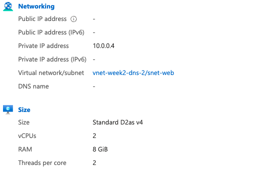
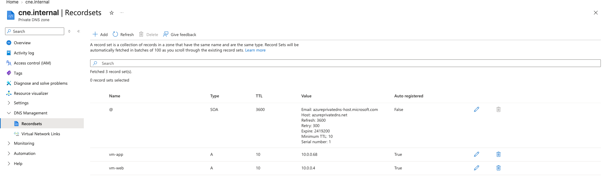
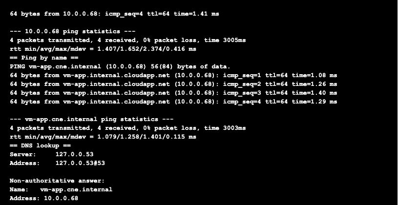

# Week 6 — Two subnets, two VMs, Private DNS

## Lab: VMs that find each other by name

### What I built
```
vnet-week2-dns-2  10.0.0.0/16  (UK South)
├── snet-web  10.0.0.0/26   → vm-web  (Ubuntu 24.04, D2as_v4)
└── snet-app  10.0.0.64/27  → vm-app  (Ubuntu 24.04, D2s_v4)

Private DNS zone: cne.internal
└── linked to the VNet with auto-registration ON
```
- No public IPs and no NSGs. Commands ran through the portal's **Run command**, so nothing was exposed to the internet.
- Private DNS zone created and linked **before** the VMs, so Azure registered each VM's name automatically.
- Auto-shutdown enabled on both VMs as a safety net; resource group deleted at the end.

### Predictions vs reality
Before building I predicted each VM's IP from the subnet ranges, using "Azure reserves the first 4 addresses":

| VM | Subnet | Predicted | Azure assigned |
|---|---|---|---|
| vm-web | 10.0.0.0/26 | 10.0.0.4 | 10.0.0.4 ✓ |
| vm-app | 10.0.0.64/27 | 10.0.0.68 | 10.0.0.68 ✓ |



### DNS auto-registration
Azure created an A record for each VM with no manual work (`Auto registered: True`). The TTL is only 10 seconds, so a changed IP is picked up almost immediately.



### Tests (run on vm-web)
```
ping -c 4 10.0.0.68
ping -c 4 vm-app.cne.internal
nslookup vm-app.cne.internal
```
- Ping by IP: 4/4 received — the two subnets route to each other by default.
- Ping by name: 4/4 received — `vm-app.cne.internal` resolved to 10.0.0.68.
- nslookup: answered by `127.0.0.53` (Ubuntu's local DNS stub on loopback, which forwards to Azure DNS). "Non-authoritative answer" = it came via a recursive resolver, not straight from the zone.
- The ping replies show `vm-app.internal.cloudapp.net` — Azure's own built-in DNS name for the VM, from a reverse (PTR) lookup.



### Problems I hit and how I fixed them
1. **No VM sizes available in North Europe.** Every size showed "Not available in this region". The quota page showed most families at a limit of 0 there. Fix: moved the lab to **UK South**. Because a VM must be in a VNet in the same region, I built a second VNet there and linked the (global) DNS zone to it. Lesson: capacity isn't guaranteed, so real designs plan for a second region.
2. **The tag policy blocks the DNS link.** The VNet link form has no Tags field, so my Week 3 "require a tag" policy can block it. Fix: create the link with Azure CLI in Cloud Shell, adding `--tags Environment=test`.
3. **VNet created in the wrong resource group.** The dropdown defaulted to the Cloud Shell group, so the link command couldn't find the VNet. Fix: `az network vnet list -o table` to find it, then `az resource move` into `rg-week2-dns`. Lesson: always check the resource group before clicking Create.

### Cost
Two 2-vCPU VMs for under an hour: well under €1. Resource group deleted after the lab.
