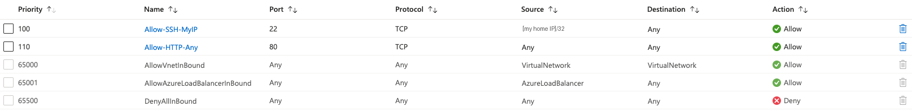
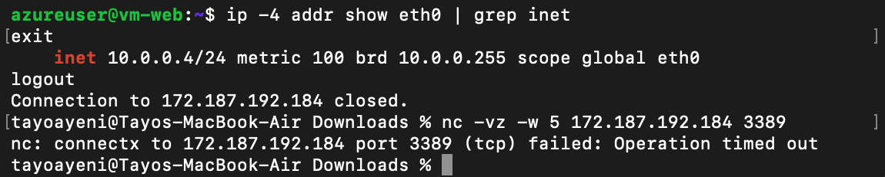
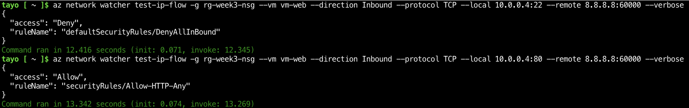

# Week 7 — NSG rules: predict, test, verify

## Lab: Rebuild my Week 2 NSG lab from memory, then prove every rule

### What I built
```
rg-week3-nsg (UK South)
└── vnet-week3-nsg  10.0.0.0/16
    └── snet-web  10.0.0.0/24
        └── vm-web  (Ubuntu 24.04 + nginx, D2s_v4, public IP)
            └── vm-web-nsg (on the NIC)
                100   Allow  TCP 22  from my home IP /32   → SSH, me only
                110   Allow  TCP 80  from Any              → the web page
                65500 DenyAllInBound (default)             → everything else
```
- SSH key pair created as its own Azure resource first, then used for the VM.
- nginx installed with **Run command** (`apt-get install -y nginx`).



### Step 1 — Predictions (before testing)
For each packet: Allow or Deny, and **which rule** decides it (rules are checked lowest number first; the first match wins).

| # | Traffic arriving at vm-web | My first prediction | Correct | Rule |
|---|---|---|---|---|
| 1 | TCP 22 from my IP | Allow | Allow | 100 |
| 2 | TCP 22 from a stranger | Deny | Deny | 65500 |
| 3 | TCP 80 from a stranger | Allow | Allow | 110 |
| 4 | TCP 3389 from my IP | Allow ✗ | **Deny** | 65500 — rule 100 only matches port 22, so coming from my IP isn't enough |
| 5 | nginx's reply going back out | Deny ✗ | **Allow** | No rule needed — NSGs are **stateful** |

VM IP: first predicted `10.0.0.0` (the network address), corrected to `10.0.0.4` — Azure reserves the first 4 addresses.

### Step 2 — Testing from my Mac
| Test | Command | Result |
|---|---|---|
| HTTP from anywhere | browser → `http://<public IP>` | "Welcome to nginx!" ✓ |
| SSH from my IP | `ssh -i vm-web-key.pem azureuser@<public IP>` | Logged in ✓ |
| RDP from my IP | `nc -vz -w 5 <public IP> 3389` | Operation timed out ✓ (denied) |

Inside the VM, `ip addr` showed only **10.0.0.4** — the VM doesn't know its public IP. Azure does static NAT between the public IP and the private one.



**Accidental extra test:** I first ran the SSH command in Azure Cloud Shell. It hung, because Cloud Shell connects from an Azure IP, not my home IP — so rule 100 didn't match and DenyAllInBound dropped it. That's prediction #2 happening for real.

### Step 3 — Asking Azure (Network Watcher IP flow verify)
```
az network watcher test-ip-flow -g rg-week3-nsg --vm vm-web --direction Inbound \
  --protocol TCP --local 10.0.0.4:22 --remote 8.8.8.8:60000
```
| Check | Azure's answer |
|---|---|
| TCP 22 from 8.8.8.8 | `Deny` — `defaultSecurityRules/DenyAllInBound` |
| TCP 80 from 8.8.8.8 | `Allow` — `securityRules/Allow-HTTP-Any` |

Both matched my predictions.



### Problems I hit and how I fixed them
1. **"adminPublicKey is not provided"** when creating the VM with "Generate new key pair". Fix: create the SSH key as its own resource (SSH keys → Create), download the private key, then pick "Use existing key stored in Azure".
2. **SSH run in the wrong place.** The `.pem` key was on my Mac, not in Cloud Shell. Fix: run SSH from the Mac's Terminal.
3. **"Failed to enable NetworkWatcher in the region."** My tag policy blocked Azure auto-creating an untagged Network Watcher. Fix: `az network watcher configure -g NetworkWatcherRG -l uksouth --enabled true --tags Environment=test`, then run IP flow verify from Cloud Shell.

### What I learned
- A rule must match on **everything** (source, port, protocol) — the right source with the wrong port doesn't match.
- NSGs are **stateful**: allowed inbound traffic gets its replies out automatically.
- Coming from Azure (e.g. Cloud Shell) is not the same as coming from my IP.
- IP flow verify names the exact rule that allowed or denied a packet — the first tool to use for "why can't I connect?".
- Stop the VM from the **portal** (Stopped (deallocated)) to stop paying; shutting down inside the OS keeps charging.

### Cost
One D2s_v4 VM for about 2 hours, stopped (deallocated) during a break: well under €1. Resource group deleted after the lab. NetworkWatcherRG kept (free).
